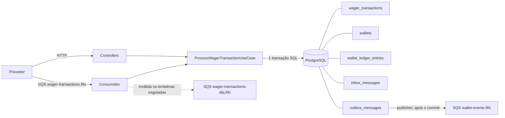

# Arquitetura

Este documento explica as decisões técnicas, os trade-offs e as limitações conhecidas da solução.

## 1. Visão geral



As duas entradas (HTTP e fila) chamam **o mesmo caso de uso**. Tudo o que uma transação produz
(linha da transação, saldo, lançamento no ledger, registro de inbox e eventos na outbox) é gravado em
**uma única transação SQL**: ou tudo é confirmado, ou nada é.

A garantia final de correção é sempre o banco. O broker (ordenação e deduplicação FIFO) é tratado
apenas como otimização.

## 2. Camadas e portas

| Camada | Conteúdo | Depende de |
| --- | --- | --- |
| `domain` | `Money`, `Wallet`, `WagerTransaction`, `WalletLedgerEntry`, `InboxMessage`, `OutboxMessage`, eventos | nada (sem NestJS, sem ORM) |
| `application` | casos de uso, validação de entrada, portas (`UnitOfWork`, `WagerStore`, `WalletQueries`, `OutboxRepository`, `EventPublisher`) | `domain` |
| `infrastructure` | adapter MikroORM, migrations, SQS, loops de background | `application`, `domain` |
| `http` | controllers, filtro de erros, guard e verificação de token | `application` |

As classes de domínio seguem a regra de modelagem do desafio: construtor privado, factories estáticas
(`create`/`open`/`from`/`receive`/`enqueue`) e `rehydrate`, que reconstrói estado persistido sem revalidar
transições. `Wallet.debit` e `Wallet.credit` são a única forma de alterar o saldo e **sempre devolvem o
lançamento de ledger correspondente**, o que torna a invariante "toda alteração de saldo tem lançamento"
estrutural. `WalletLedgerEntry` só tem campos `readonly`.

Ids e datas são passados de fora para o domínio (UUID v7 gerado pelo Bun), o que o mantém puro e os
testes determinísticos.

## 3. ORM: MikroORM

Escolhido por ser a opção preferencial e por oferecer exatamente o que o problema pede:
`EntityManager.transactional()`, Unit of Work e Identity Map por operação e `LockMode.PESSIMISTIC_WRITE`.

Como é usado:

- **Records separados do domínio.** As tabelas são mapeadas com `defineEntity` em `records.ts`, sem
  decorators, e o adapter converte record ⇄ classe de domínio. O domínio não conhece o ORM.
- **Um `EntityManager` novo (`fork`) por unidade de trabalho**, portanto um Identity Map por transação.
- **Escritas na ordem do caso de uso.** Cada operação do `WagerStore` faz `flush` imediatamente dentro
  da transação. Abre-se mão do batch do Unit of Work em troca de ordem explícita de SQL (transação →
  wallet → ledger → outbox), que respeita as chaves estrangeiras sem declarar relações entre records.
- **SQL explícito onde o ORM não agrega**: `FOR UPDATE SKIP LOCKED` da outbox, cursor do ledger e
  totais da reconciliação.
- **Migrations** escritas à mão em SQL (classe `Migration` do MikroORM, com `up` e `down`) e registradas
  em lista explícita, sem varredura de arquivos. Assim o schema, as constraints e os índices são
  exatamente os descritos na seção 9.

## 4. Money

- No domínio, `Money` guarda um `Decimal` (decimal.js) e a moeda. É imutável.
- Entrada e saída são sempre string decimal com exatamente 2 casas (`"25.00"`). São rejeitados:
  `NaN`, `Infinity`, notação científica, string vazia, mais ou menos de 2 casas, sinal, zeros à
  esquerda e valores que não sejam string.
- Valores negativos são rejeitados em contratos de entrada (`Money.from`), mas podem existir
  internamente como resultado de `subtract`/`negate`, o que é usado na diferença da reconciliação.
- Na persistência: coluna `NUMERIC(20,2)` + coluna `currency CHAR(3)`. O ORM mapeia `NUMERIC` como
  **string** (`p.decimal('string')`), nunca como `number`, e o adapter reidrata como `Money`.
- O modelo é multi-moeda (unicidade por `player_id + currency`, moeda validada em cada operação). Os
  testes usam BRL e cobrem conflitos de moeda.

## 5. Concorrência e estratégia transacional

**Estratégia: pessimistic locking por wallet, com o banco como segunda barreira.**

1. Toda operação começa com `SELECT ... FOR UPDATE` na linha da wallet. Operações da mesma wallet
   entram em fila no PostgreSQL, **em qualquer instância**. Wallets diferentes não esperam umas pelas
   outras e não existe lock global.
2. Com o lock em mãos, o caso de uso lê o saldo, decide (`Wallet.debit` recusa saldo insuficiente) e
   grava. Não há `read → calculate → update` sem controle.
3. `CHECK (balance >= 0)` e as constraints do ledger continuam valendo mesmo que o código tenha um bug.

Por que pessimista e não otimista: em uma hot wallet o lock otimista gera rajadas de conflito e
retries, com latência imprevisível. O lock de linha entrega fila justa, sem retry e sem lost update, e
cada transação SQL é curta (poucos comandos). O campo `version` é mantido como exige o domínio
(começa em 1 e incrementa somente quando o saldo muda) e é publicado nos eventos, mas não é o
mecanismo de controle.

Deadlocks: cada transação bloqueia **uma única** linha de wallet, então não há ciclo de locks entre
wallets. Como proteção, há `lock_timeout` de 5 s por transação (`DB_LOCK_TIMEOUT_MS`): se estourar,
a resposta é `503` (seguro reenviar) e a métrica `wager_lock_conflicts_total` é incrementada.

Trade-off: o throughput de uma única wallet é serial. Isso é intencional, porque a `walletId` é a
unidade de concorrência.

## 6. Idempotência

- O header `Idempotency-Key` é obrigatório e é a fonte da verdade (na fila, `data.idempotencyKey`).
- `payloadHash` = **SHA-256 (hex) do JSON canônico** (chaves ordenadas em todos os níveis, sem
  espaços, campos `undefined` omitidos) deste subconjunto de campos de negócio: `providerId`,
  `externalTransactionId`, `playerId`, `walletId`, `roundId`, `gameId`, `kind`, `money.amount`,
  `money.currency`, `referenceExternalTransactionId`. Header e metadados de transporte não entram.
- A deduplicação é **persistente**: constraints `UNIQUE (idempotency_key)` e
  `UNIQUE (provider_id, external_transaction_id)`. Não há cache em memória.
- Fluxo: com o lock da wallet, busca-se a transação pela key (ou pelo par provedor + id externo).
  - Existe, mesma key e mesmo hash → **replay**: devolve o resultado gravado, com
    `idempotentReplay: true` e o saldo observado na época (`result_balance`).
  - Existe, com key ou payload diferente → **conflito** (`409`), nunca replay.
  - Não existe → processa e grava.
- Quando não há wallet para serializar (wallet inexistente) ou as requisições miram wallets
  diferentes, duas cópias podem tentar inserir ao mesmo tempo. A constraint deixa apenas uma vencer; a
  outra recebe violação de unicidade, faz rollback, **executa de novo** e cai no caminho de replay ou
  conflito.

## 7. Estados da transação

```
PENDING ──────────────► PROCESSED            (terminal)
   │  ├────────────────► REJECTED             (terminal, regra de negócio)
   │  └────────────────► FAILED               (terminal, erro permanente de infraestrutura)
   └──► PENDING_REFERENCE ──► PROCESSED | REJECTED | FAILED
              └──► PENDING_REFERENCE (nova tentativa)
```

Tentar transicionar um estado terminal lança `InvalidTransactionStateError` (erro de programação).
O banco reforça a coerência: status terminal ⇔ `processed_at` preenchido; `REJECTED`/`FAILED` ⇔
`failure_code` preenchido.

`PENDING` nunca é persistido: a transação nasce e chega ao seu resultado dentro da mesma transação SQL.
`FAILED` existe no domínio e no schema, mas os fluxos atuais não o produzem (ver seção 15).

## 8. Regras de negócio e interpretações adotadas

Além das regras da seção 7 do desafio:

1. **Wallet inexistente, de outro jogador ou de outra moeda** → transação gravada como `REJECTED`
   (`WALLET_NOT_FOUND`, `WALLET_PLAYER_MISMATCH`, `CURRENCY_MISMATCH`). Por isso
   `wager_transactions.wallet_id` não tem chave estrangeira: a rejeição precisa ficar auditável.
2. **Referência de REFUND/ROLLBACK** é resolvida por `(providerId, referenceExternalTransactionId)` e
   validada nesta ordem: está `PROCESSED`; mesmo player, wallet, rodada e moeda; tipo permitido
   (REFUND → BET; ROLLBACK → BET, WIN ou REFUND); mesmo valor; ainda não revertida pelo mesmo tipo.
3. **"Uma única vez pelo mesmo tipo de operação"** foi seguido literalmente: uma BET pode receber um
   REFUND e também um ROLLBACK. Evitar a dupla devolução nesse caso é responsabilidade do provedor.
   Bloquear a combinação seria uma mudança pequena (índice único e verificação sem a coluna `kind`).
4. **Referência encontrada mas ainda não terminal** (ela mesma em `PENDING_REFERENCE`) é tratada como
   ausente: a transação aguarda.
5. **WIN e LOSS podem informar** `referenceExternalTransactionId`. O vínculo é informativo: é gravado
   se apontar para uma BET da mesma wallet e rodada, e ignorado caso contrário.
6. **LOSS aceita valor zero**; os demais tipos exigem valor maior que zero.
7. **Reversão que deixaria o saldo negativo** → `REJECTED` com `REVERSAL_WOULD_OVERDRAW`, distinto de
   `INSUFFICIENT_FUNDS`.
8. **`OPENING`** só é criado internamente por `POST /wallets` (provedor `internal`); é recusado na API
   e na fila.
9. `POST /wallets` não usa `Idempotency-Key`: a unicidade `player + currency` devolve `409` na repetição.

## 9. Schema, constraints e índices

| Garantia | Onde está no banco |
| --- | --- |
| Uma wallet por `playerId + currency` | `wallets_player_currency_uq` |
| Saldo nunca negativo | `wallets_balance_non_negative_ck` |
| Idempotência | `wager_tx_idempotency_key_uq`, `wager_tx_provider_external_uq` |
| REFUND/ROLLBACK exigem referência | `wager_tx_reference_required_ck` |
| Tipos e status válidos | `wager_tx_kind_ck`, `wager_tx_status_ck` |
| Coerência de estado terminal | `wager_tx_terminal_timestamp_ck`, `wager_tx_failure_code_ck` |
| Referência revertida uma vez por tipo | índice único parcial `wager_tx_single_reversal_uq` |
| No máximo um lançamento por transação e wallet | `ledger_one_entry_per_tx_wallet_uq` |
| Aritmética do lançamento | `ledger_arithmetic_ck`, `ledger_amount_positive_ck`, `ledger_balances_non_negative_ck` |
| Ledger imutável | triggers que recusam `UPDATE`, `DELETE` e `TRUNCATE` |
| Inbox: uma vez por consumidor e mensagem | chave primária `(consumer_name, message_id)` |

Índices de trabalho: `ledger_wallet_seq_uq (wallet_id, seq)` para o cursor e a reconciliação;
`outbox_pending_idx` (parcial, só não publicados) para o publisher; `wager_tx_pending_reference_idx`
(parcial) para o worker de referências; `wager_tx_wallet_idx (wallet_id, created_at)`.

O cursor do ledger é a posição `seq` (identity gerada pelo banco) codificada em base64url: estável,
opaco e imune a inserções concorrentes.

## 10. Códigos de falha

Estáveis e legíveis por máquina (`failureCode` na resposta, na linha da transação e nos eventos).

| Código | Significado | O provedor deve |
| --- | --- | --- |
| `INSUFFICIENT_FUNDS` | BET maior que o saldo | desistir (ou nova aposta com outro id) |
| `REVERSAL_WOULD_OVERDRAW` | reversão deixaria o saldo negativo | desistir; tratar operacionalmente |
| `WALLET_NOT_FOUND` | wallet inexistente | corrigir (nova transação) |
| `WALLET_PLAYER_MISMATCH` | wallet não pertence ao jogador | corrigir |
| `CURRENCY_MISMATCH` | moeda diferente da wallet | corrigir |
| `REFERENCE_NOT_FOUND` | referência não chegou dentro do limite | reenviar a referência e uma nova reversão |
| `REFERENCE_MISMATCH` | referência de outro player, wallet, rodada ou moeda | corrigir |
| `REFERENCE_KIND_NOT_ALLOWED` | tipo da referência não pode ser revertido assim | corrigir |
| `REFERENCE_NOT_PROCESSED` | referência foi rejeitada, nada a reverter | desistir |
| `REFERENCE_ALREADY_REVERSED` | já revertida por esse tipo | desistir |
| `AMOUNT_MISMATCH` | valor diferente do da referência | corrigir |
| `INFRASTRUCTURE_FAILURE` | erro permanente de infraestrutura (`FAILED`) | contatar suporte |

Como a rejeição é o resultado definitivo daquela key, "corrigir" significa enviar uma nova transação
com outro `externalTransactionId`. Erros de transporte usam `error.code`: `VALIDATION_ERROR`,
`INVALID_MONEY`, `INVALID_TRANSACTION`, `IDEMPOTENCY_CONFLICT`, `WALLET_ALREADY_EXISTS`, `NOT_FOUND`,
`TRANSIENT_FAILURE`, `UNAUTHENTICATED`, `FORBIDDEN`.

## 11. Mapeamento HTTP

| Situação | Status |
| --- | --- |
| Transação aplicada (`PROCESSED`) | `200` |
| Aceita, processamento pendente (`PENDING_REFERENCE`) | `202` |
| Rejeição por regra de negócio (`REJECTED`) | `422` + `failureCode` |
| Payload inválido / header ausente | `400` |
| Recurso inexistente (consultas) | `404` |
| Conflito de idempotência ou wallet duplicada | `409` |
| Falha transitória de infraestrutura | `503` + `Retry-After` |
| Token ausente ou inválido | `401` + `WWW-Authenticate: Bearer` |
| Token válido sem permissão | `403` |
| Wallet criada | `201` |

O status depende apenas do estado da transação, então um replay recebe o mesmo status da resposta
original. O provedor decide pelo código, sem interpretar mensagens: `503` → reenviar; `400`/`409`/`422`
→ não reenviar igual.

## 12. Referências fora de ordem

Uma REFUND/ROLLBACK cuja referência ainda não chegou é gravada como `PENDING_REFERENCE` (HTTP `202`,
evento `WagerTransactionPendingReference` publicado uma vez). Um worker agendado em cada instância
reprocessa as vencidas com backoff exponencial.

- **Limite: 6 tentativas**, com esperas de 5 s, 10 s, 20 s, 40 s, 80 s e 160 s (cerca de 5 minutos no
  total). Cobre atrasos normais de entrega at-least-once sem manter reversões pendentes para sempre.
  Configurável por `REFERENCE_MAX_ATTEMPTS` e `REFERENCE_RETRY_BASE_MS`.
- Esgotado o limite: `REJECTED` com `REFERENCE_NOT_FOUND` e evento `WagerTransactionRejected`.
- Várias instâncias podem pegar a mesma transação: o caso de uso relê o estado **depois** de obter o
  lock da wallet e ignora o que já foi resolvido.

## 13. Consumidor SQS e inbox

- Reutiliza `ProcessWagerTransactionUseCase.submit`, com a mesma validação da entrada HTTP.
- **Inbox na mesma transação SQL**: o registro `(consumerName, messageId)` é gravado junto com o efeito
  financeiro. Uma redelivery encontra o registro e apenas confirma a mensagem. Mesmo sem a inbox, a
  idempotency key impediria o efeito duplicado; são duas barreiras independentes.
- **Ack somente após o commit.** Se o worker morrer entre o commit e o ack, a mensagem volta e é
  reconhecida como duplicata.
- Classificação de erros:

| Tipo | Exemplos | Ação |
| --- | --- | --- |
| Resultado de negócio | `REJECTED` por saldo insuficiente | ack (é uma resposta final) |
| Permanente | JSON inválido, payload inválido, `OPENING`, conflito de idempotência | DLQ imediatamente, com atributo `reason` |
| Transitório | banco indisponível, timeout de lock, erro inesperado | retry com backoff via visibilidade (2 s, 4 s, 8 s, ... até 300 s) |
| Tentativas esgotadas | 5 entregas (`CONSUMER_MAX_RECEIVES`) | DLQ com `reason=MAX_RECEIVES_EXCEEDED` |

- O próprio consumidor move para a DLQ, de forma determinística. A `RedrivePolicy` da fila
  (`maxReceiveCount` = limite + 2) é rede de segurança para um consumidor que cai antes de conseguir mover.
- **SIGTERM**: o loop para de buscar mensagens, conclui a que está em andamento e devolve a visibilidade
  das demais do lote. Só depois as conexões com banco e SQS são fechadas.
- Não se confia na ordenação FIFO para a consistência: mensagens fora de ordem são tratadas pelo
  mecanismo da seção 12 e duplicadas pela inbox.

## 14. Transactional outbox

- Os eventos são inseridos em `outbox_messages` na mesma transação da alteração financeira. **Nenhum
  evento é publicado antes do commit**, e nenhum evento confirmado se perde.
- O publisher (um loop por instância) seleciona os pendentes com `FOR UPDATE SKIP LOCKED`, publica em
  `wallet-events.fifo` e marca `published_at`. Vários publishers trabalham em paralelo sem pegar a mesma
  linha.
- Falha ao publicar: `attempts` + 1 e `next_attempt_at` com backoff exponencial (1 s até 5 min). O
  evento nunca é descartado.
- **Processo morre depois do commit e antes de publicar**: as linhas continuam pendentes e outra
  instância publica.
- **Entrega at-least-once**: se o processo morrer depois de publicar e antes de marcar, o evento é
  publicado de novo. A duplicata é segura: `MessageDeduplicationId = eventId` (janela de 5 minutos do
  SQS FIFO) e o `eventId` vai no corpo para o consumidor deduplicar além dessa janela.
- `MessageGroupId = aggregateId`, preservando a ordem por agregado dentro do SQS.
- Eventos: `WagerTransactionProcessed` (inclusive LOSS e OPENING), `WagerTransactionRejected`,
  `WagerTransactionPendingReference` e `WalletBalanceChanged` (somente quando o saldo muda). Cada um é
  uma subclasse de `IntegrationEvent` com `eventType` e `version` no tipo; `data` carrega `MoneyProps`.

Trade-off: a transação SQL do publisher fica aberta durante a chamada ao SQS. Os lotes são pequenos
(20) para limitar esse tempo; a alternativa (marcar "em envio" e confirmar depois) exigiria um estado e
um reaper a mais.

## 15. Falhas de infraestrutura

- **PostgreSQL indisponível**: HTTP responde `503`; o consumidor deixa a mensagem na fila para retry; os
  loops de background registram a falha e tentam de novo com pausa crescente (até 10 s).
- **SQS indisponível**: a aplicação sobe mesmo assim (as URLs das filas são resolvidas sob demanda); a
  entrada HTTP continua funcionando e os eventos se acumulam na outbox (`wager_outbox_lag_seconds`).
  `GET /health/ready` responde `503` enquanto PostgreSQL ou SQS estiverem fora.
- **Status `FAILED`**: não é produzido hoje. Um erro de infraestrutura faz rollback da transação
  inteira, então não sobra linha para marcar; na fila, o registro auditável do erro permanente é a
  mensagem na DLQ com o motivo. O estado fica disponível para um fluxo operacional (por exemplo,
  marcar como `FAILED` as transações de mensagens descartadas da DLQ).

## 16. Observabilidade

- **Logs**: um objeto JSON por linha, com `correlationId`, `messageId`, `transactionId`, `walletId`,
  `providerId`, `kind`, `status` e `failureCode`. Valores, saldos e payloads completos **não** são
  logados. O `correlationId` vem do header `X-Correlation-Id` (ou é gerado), é devolvido na resposta,
  gravado na transação e propagado nos eventos; na fila, é o `messageId`.
- **Métricas** (`GET /metrics`, formato Prometheus):

| Métrica | Cobre |
| --- | --- |
| `wager_transactions_total{kind,status}` | transações por status |
| `wager_duplicates_total{source}` | duplicatas detectadas (replays HTTP e redeliveries) |
| `wager_idempotency_conflicts_total` | mesma key com payload diferente |
| `wager_retries_total{component}` | retries do consumidor, da outbox e de referências |
| `wager_dlq_messages_total{reason}` | mensagens enviadas à DLQ |
| `wager_lock_conflicts_total{kind}` | timeouts de lock, deadlocks e corridas de insert |
| `wager_outbox_pending`, `wager_outbox_lag_seconds`, `wager_outbox_published_total` | outbox |
| `wager_processing_duration_seconds{source}` | latência de processamento (histograma) |
| `wager_reconciliation_mismatches_total` | divergências entre saldo e ledger |

- **Health**: `/health/live` não toca dependências; `/health/ready` verifica PostgreSQL e SQS.
- **Reconciliação**: compara o saldo armazenado com créditos − débitos do ledger. Divergência é logada
  como erro, contada em métrica e sinalizada na resposta (`consistent: false`); nada é corrigido.

## 17. Autenticação

Implementada com um **Identity Provider externo** (Keycloak, OIDC), sem autenticação artesanal: o
serviço não tem tabela de usuários, senhas nem segredo de assinatura.

- **Fluxo**: cada provedor de jogos é um client com *client credentials*. Ele obtém um access token no
  Keycloak e o envia em `Authorization: Bearer`.
- **Validação** (`TokenVerifier`, biblioteca `jose`): assinatura conferida com as chaves públicas do
  Keycloak (JWKS, buscadas sob demanda e mantidas em cache), além de `iss`, `aud` e `exp`. Só
  algoritmos assimétricos são aceitos; token sem assinatura (`alg: none`) é recusado.
- **Identidade vem do token, nunca da requisição.** O realm grava em cada client as claims
  `provider_id` e `wagering_role` (`provider` ou `operator`) e a audiência `wagering-api`.
- **Autorização** (`ProviderAuthGuard`):

| Regra | Resposta |
| --- | --- |
| Sem token, token inválido, expirado, de outro emissor ou outra audiência | `401` |
| `providerId` do corpo ou da rota diferente do `provider_id` do token | `403` |
| Provedor em endpoint de operador (`POST /wallets`, reconciliação) | `403` |
| Provedor consultando por id uma transação de outro provedor | `404` (não revela que existe) |
| Token válido sem `provider_id` e sem papel de operador | `403` |
| Keycloak inacessível para buscar as chaves | `503` (falha transitória, não culpa do chamador) |

- O operador pode criar wallets, reconciliar e atuar por qualquer provedor. Consultas de wallet e
  ledger aceitam qualquer identidade autenticada.
- **Escopo**: health e métricas ficam abertos. Mensagens da fila são canal interno confiável; o
  `providerId` da mensagem passa pelas mesmas validações de domínio.
- **Chave `AUTH_ENABLED`**: ligada no Docker Compose e desligada por padrão em desenvolvimento local e
  nos demais testes, que exercitam regras financeiras e não precisam de um IdP. Em produção ficaria
  sempre ligada.
- **Emissor e JWKS são configurados separadamente** (`AUTH_ISSUER` e `AUTH_JWKS_URL`): no Compose, o
  token é emitido em `localhost:8080`, mas a aplicação alcança o Keycloak pela rede interna.

Limitações desta parte: Keycloak em modo de desenvolvimento e secrets fixos no realm (apenas ambiente
local); as wallets não são associadas a provedores, então qualquer provedor autenticado pode consultar
uma wallet cujo id conheça; não há rate limiting por client.

## 18. Estratégia de testes

- **Unidade** (`src/domain`): Money, Wallet, ledger e máquina de estados, sem infraestrutura.
- **Integração** com PostgreSQL e MiniStack reais (nenhum dos dois é substituído por mock): constraints
  e migrations, regras de negócio, atomicidade (uma falha forçada na última escrita desfaz tudo), inbox,
  retry, DLQ e outbox.
- **Concorrência real**: requisições simultâneas em conexões distintas (`Promise.all`) e **três
  processos do sistema operacional** rodando a aplicação, incluindo uma instância morta com `SIGKILL`
  sob carga e substituída por outra.
- Falhas são simuladas na borda certa: o "worker que morre antes do ack" usa a fila real e falha
  exatamente no `DeleteMessage`; o "processo que morre antes de publicar" usa a outbox real.
- **Autenticação**: o guard e a verificação de assinatura são reais; o IdP é substituído por um servidor
  HTTP que publica uma chave pública (JWKS), como o Keycloak faz, e os tokens são assinados no teste.
- Todo arquivo termina verificando que nenhuma wallet diverge do seu ledger.

## 19. Limitações conhecidas

- **Autenticação** com as limitações descritas na seção 17 (IdP em modo de desenvolvimento, wallets sem dono por provedor).
- **Métricas em memória, por instância.** O agregador (Prometheus) soma as instâncias; contadores zeram
  no restart. OpenTelemetry e dashboards não foram implementados.
- **Hot wallet é serial** por desenho (seção 5).
- **Ordem dos eventos** é garantida por agregado dentro do SQS, não globalmente; com vários publishers,
  eventos de agregados diferentes podem sair fora da ordem de commit.
- **Outbox e inbox crescem indefinidamente**: falta uma rotina de expurgo/arquivamento de linhas antigas.
- **DLQ**: o reprocessamento é manual; não há ferramenta de redrive.
- **Reversão parcial** está fora de escopo; REFUND + ROLLBACK da mesma BET são ambos aceitos (seção 8, item 3).
- **Uma mensagem com `messageId` repetido e conteúdo diferente** é tratada como duplicata da primeira.
- **Ledger de partidas simples** (não double-entry) e **sem teste de carga**: ambos eram diferenciais
  opcionais.
- **Criação das filas pela aplicação** é conveniência de ambiente local; em produção seriam provisionadas
  por infraestrutura como código (`SQS_CREATE_QUEUES=false`).
